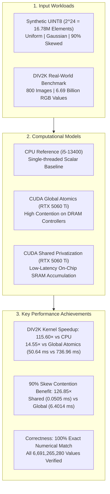
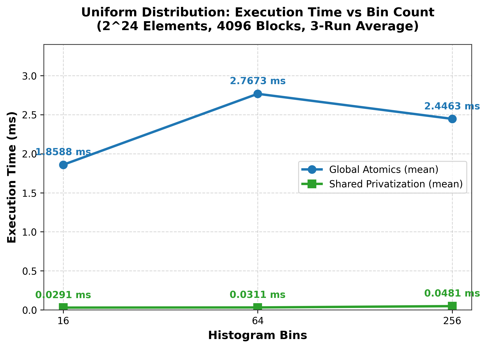
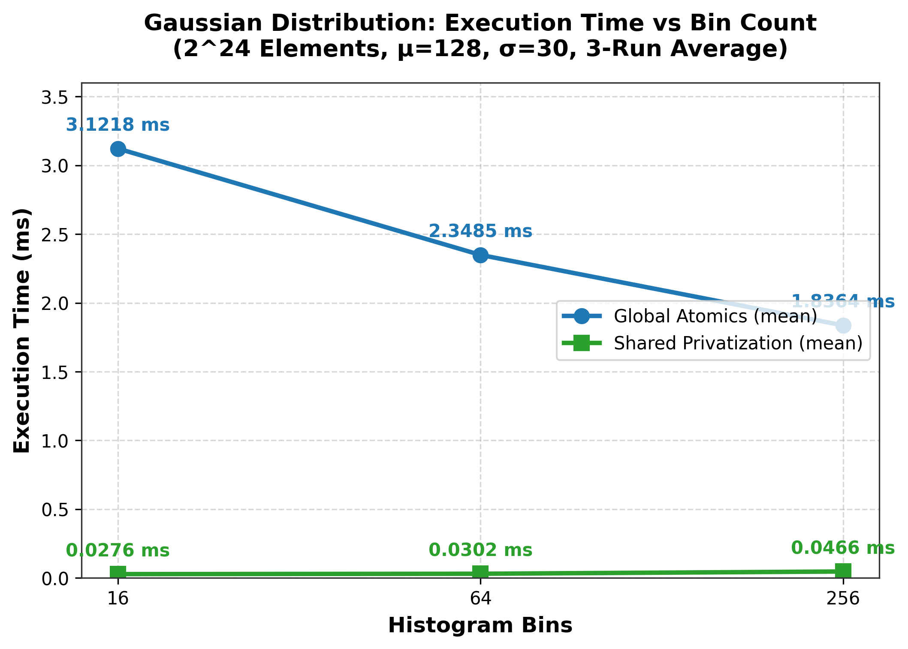
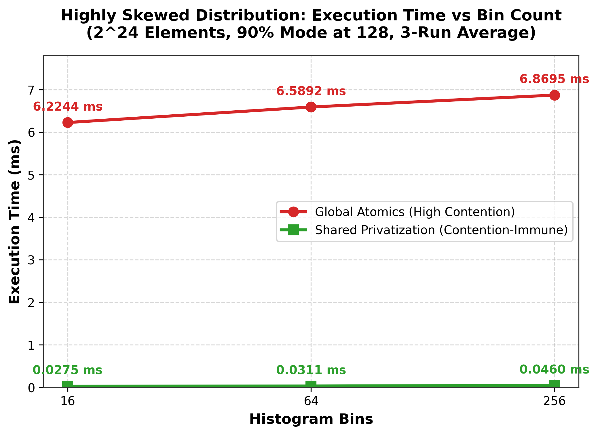
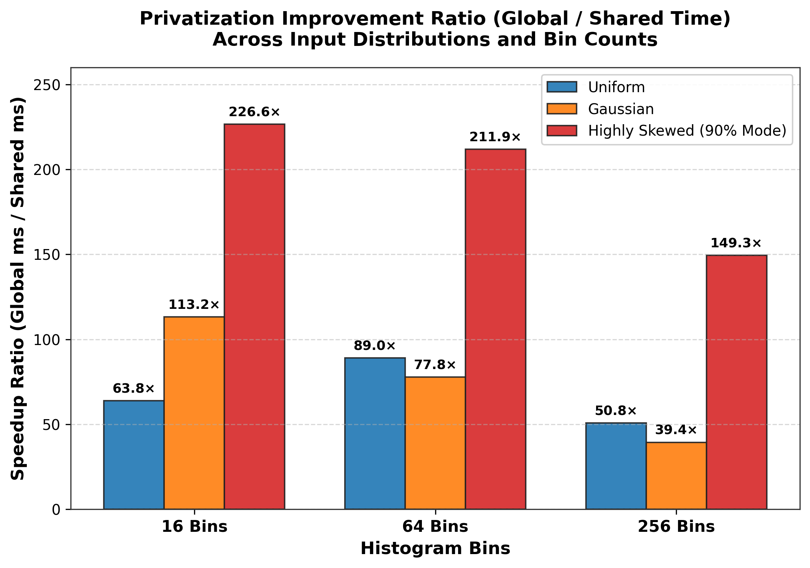
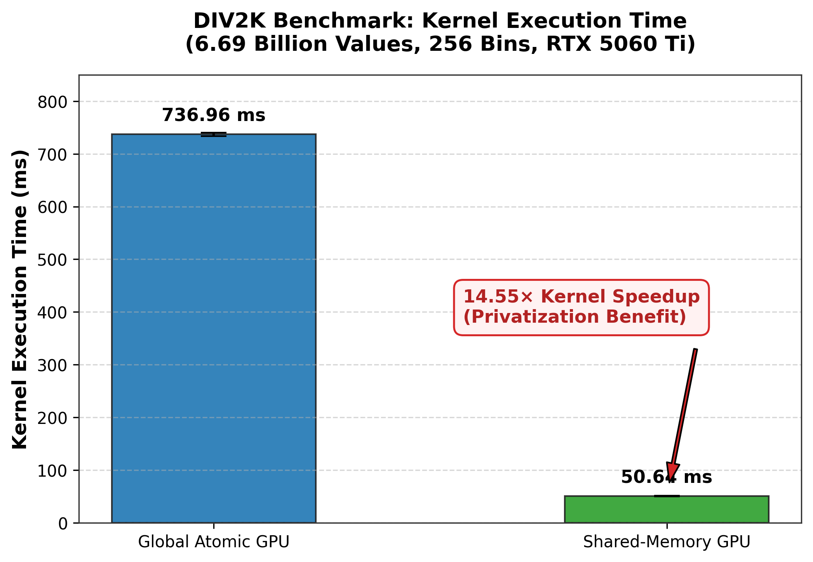
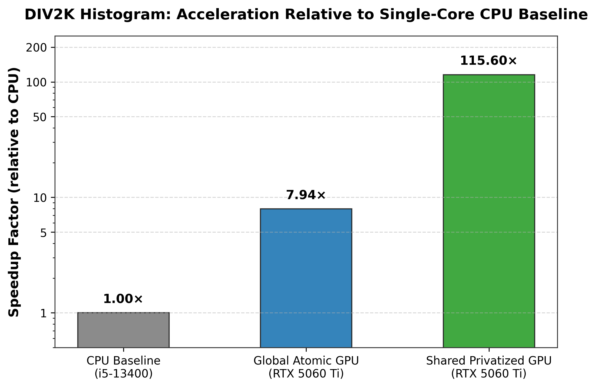
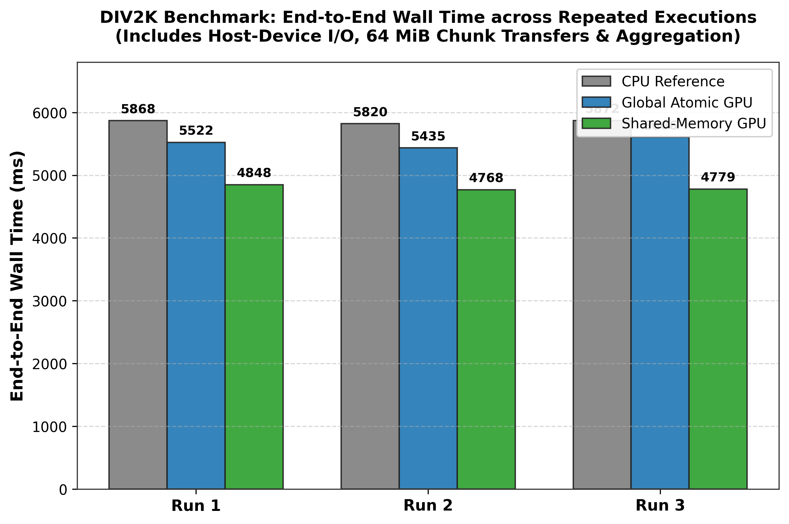

# CUDA-Accelerated Histogram Computation Using Global Atomics and Shared-Memory Privatization on Large-Scale Image Datasets

[](#)
[](#)
[](#)
[-orange.svg)](#)
[](#)

---

## Executive Summary

This repository contains the complete implementation, benchmark analysis, and empirical evaluation for **CUDA-Accelerated Histogram Computation** on large-scale datasets. Designed for **Academic Theme 3 (Histogram with Atomics and Privatization)**, this project investigates how data distribution skew, atomic contention, histogram bin count, and the GPU memory hierarchy affect histogram generation performance.

The project evaluates two CUDA implementations against a single-threaded CPU reference baseline:
1. **CUDA Global Atomics (`global_histogram.cu`)**: Direct global DRAM atomic increments (`atomicAdd()`).
2. **CUDA Shared-Memory Privatization (`shared_histogram.cu`)**: Block-private SRAM sub-histograms with local atomic reduction followed by a cooperative global block-merge.



---

## 1. Problem Statement & Motivation

A histogram calculates the frequency of values in a dataset by dividing the possible value range into $B$ discrete bins and counting how many input values belong to each bin. For standard 8-bit image data (UINT8), pixel intensity values range from 0 to 255, producing a 256-bin histogram.

### Why Atomic Contention Matters on GPUs
On massively parallel GPU architectures, thousands of threads execute concurrently. When multiple threads attempt to update the same histogram bin simultaneously:
- **Global Memory Atomic Contention:** In a naive implementation, all threads issue `atomicAdd()` directly to a single global histogram buffer residing in DRAM. If the input distribution is skewed (e.g., an image with large monochromatic regions), thousands of threads compete for the same memory address. The hardware memory controllers serialize these operations, stalling execution pipelines and causing drastic performance degradation.
- **Shared-Memory Privatization:** By privatizing histogram counters inside fast, on-chip shared memory (`__shared__`) for each thread block, contention is localized to the 256 threads of that block. Once all block threads finish processing their assigned input tiles, the partial block histograms are merged into the global buffer via a single reduction step per bin.

---

## 2. Hardware and Software Environment

All benchmarks were executed on physical hardware:

| Component | Specification |
|:---|:---|
| **CPU** | 13th Gen Intel Core i5-13400 (10 Cores, 16 Threads, up to 4.60 GHz) |
| **System Memory (RAM)** | 31.77 GiB DDR5 (~32 GB) |
| **GPU** | NVIDIA GeForce RTX 5060 Ti |
| **GPU Architecture** | Blackwell / Ada-Lovelace Generation (`sm_120`) |
| **Compute Capability** | 12.0 |
| **Video Memory (VRAM)** | 16,311 MiB (~16 GB GDDR6) |
| **Operating System** | Windows 11 Professional (Build 26200) |
| **CUDA Toolkit** | CUDA 13.5 (Driver 610.88, CUDA UMD 13.3) |
| **Host Compiler** | Microsoft Visual Studio (MSVC) Build Tools 2022 |
| **CUDA Compiler** | NVIDIA NVCC (`-std=c++17 -O2 -arch=sm_120`) |
| **Python Environment** | Python 3.13.17 / NumPy 2.5.5 / Pillow 13.0.0 / Matplotlib 3.10 |

---

## 3. Repository Architecture

```text
Lab_evaluation_2/
├── README.md                              # Comprehensive project documentation
├── LICENSE                                # MIT Open Source License
├── CMakeLists.txt                         # Cross-platform build configuration
├── .gitignore                             # Excludes binaries, object files & 6.23GB dataset
│
├── src/                                   # Core C++/CUDA source files
│   ├── cpu_histogram.cpp                  # Single-threaded CPU baseline reference
│   ├── global_histogram.cu                # CUDA global memory atomic implementation
│   ├── shared_histogram.cu                # CUDA shared-memory privatized implementation
│   ├── distribution_experiment.cu         # Float-based distribution exploration
│   ├── uint8_distribution_experiment.cu   # Synthetic 2^24 UINT8 contention experiment
│   ├── uint8_bin_count_experiment.cu      # Bin-count scaling (16, 64, 256 bins)
│   ├── div2k_histogram_benchmark.cu       # 6.69B element DIV2K streaming benchmark
│   ├── quantization_calibration.cu        # AI Extension: INT8 quantization calibration
│   └── gpu_parallel_cdf.cu                # AI Extension: On-device parallel CDF (Hillis-Steele)
│
├── scripts/                               # Python automation & analytical tools
│   ├── prepare_div2k.py                   # Converts 800 DIV2K images to raw binary
│   ├── analyze_div2k.py                   # Computes Shannon entropy, CV, and channel stats
│   ├── consolidate_results.py             # Statistical aggregator across repeated runs
│   └── generate_analysis.py               # Generates all publication-grade 300 DPI graphs
│
├── results/                               # Verified experimental results & figures
│   ├── div2k_kernel_comparison.png        # Kernel time: Global vs Shared
│   ├── div2k_cpu_gpu_comparison.png       # Speedup relative to single-threaded CPU
│   ├── div2k_wall_comparison.png          # End-to-end wall-clock time across 3 runs
│   ├── bin_count_uniform.png              # Uniform distribution bin scaling
│   ├── bin_count_gaussian.png             # Gaussian distribution bin scaling
│   ├── bin_count_highly_skewed.png        # Skewed distribution bin scaling
│   ├── bin_count_speedup_comparison.png   # Privatization speedup ratio across bins & distributions
│   ├── div2k_results.csv                  # Raw repeated-run measurements
│   ├── div2k_statistical_summary.csv      # Mean, std dev, and speedup metrics
│   ├── div2k_repeated_runs.txt            # Formatted execution logs
│   ├── bin_count_results.csv              # Multi-bin experimental raw data
│   ├── bin_count_statistical_summary.csv  # Multi-bin statistical averages
│   └── bin_count_repeated_runs.txt        # Multi-bin detailed logs
│
├── images/                                # Raw terminal execution screenshots (hardware proof)
│   ├── Screenshot 2026-11-25 064139.png   # nvcc --version & nvidia-smi (RTX 5060 Ti)
│   ├── Screenshot 2026-11-25 064155.png   # System specs, cpu_histogram & global_histogram
│   ├── Screenshot 2026-11-25 064210.png   # shared_histogram (0.83ms CPU vs 0.012ms GPU)
│   ├── Screenshot 2026-11-25 064219.png   # uint8_distribution (Uniform)
│   ├── Screenshot 2026-11-25 064233.png   # uint8_distribution (Gaussian & Skewed)
│   ├── Screenshot 2026-11-25 064248.png   # uint8_bin_count (Uniform 16, 64 bins)
│   ├── Screenshot 2026-11-25 064259.png   # uint8_bin_count (Uniform 256, Gaussian 16, 64)
│   ├── Screenshot 2026-11-25 064316.png   # DIV2K training set directory listing
│   ├── Screenshot 2026-11-25 064338.png   # analyze_div2k.py execution (6.69B values)
│   ├── Screenshot 2026-11-25 064359.png   # DIV2K dataset validation: PASSED
│   ├── Screenshot 2026-11-25 064411.png   # quantization_calibration (INT8 percentiles)
│   ├── Screenshot 2026-11-25 064437.png   # gpu_parallel_cdf (Uniform)
│   ├── Screenshot 2026-11-25 064457.png   # gpu_parallel_cdf (Gaussian & ReLU)
│   └── Screenshot 2026-11-25 064505.png   # gpu_parallel_cdf (Skewed Exponential)
│
├── docs/                                  # Academic documentation & presentation outlines
│   ├── technical_report.md                # Comprehensive IEEE-style technical report
│   ├── experimental_methodology.md        # Benchmarking protocols & timing boundaries
│   └── presentation_outline.md            # 5-checkpoint presentation guide
│
└── dataset/                               # Dataset documentation & attribution
    └── README.md                          # Download instructions & streaming layout
```

---

## 4. Experimental Results

### 4.1 Experiment 1: Baseline 1M Elements Verification
- **Workload:** $N = 1,048,576$ elements, $B = 256$ bins, 4096 blocks, 256 threads/block.
- **Recorded Runtimes:**
  - CPU Reference: $0.8361\text{ ms}$
  - Global Atomic GPU: $0.1562\text{ ms}$ ($5.3539\times$ speedup)
  - Shared-Memory GPU: $0.0126\text{ ms}$ ($66.1890\times$ speedup)
- **Privatization Advantage:** **12.3628× speedup** of shared memory over global atomics.
- **Verification:** 100% exact numerical match ($1,048,576$ elements accounted for).

---

### 4.2 Experiment 2: Synthetic UINT8 Distribution & Atomic Contention ($N = 2^{24} = 16,777,216$)
Evaluated on the NVIDIA GeForce RTX 5060 Ti using 4096 blocks and 256 threads per block (10 GPU timing repetitions):

| Distribution Pattern | Shannon Entropy | CPU Time | Global Atomic | Shared Privatized | Global Speedup | Shared Speedup | Shared vs Global Ratio |
|:---|---:|---:|---:|---:|---:|---:|---:|
| **Uniform** | $8.0000\text{ bits}$ | $4.4961\text{ ms}$ | $2.4348\text{ ms}$ | $0.0518\text{ ms}$ | $1.85\times$ | $86.71\times$ | **46.96×** |
| **Gaussian** ($\mu=128, \sigma=30$) | $6.9541\text{ bits}$ | $5.0615\text{ ms}$ | $1.8216\text{ ms}$ | $0.0506\text{ ms}$ | $2.78\times$ | $99.99\times$ | **35.99×** |
| **Highly Skewed** (90% Mode at 128) | $1.2642\text{ bits}$ | $23.6067\text{ ms}$ | $6.4014\text{ ms}$ | $0.0505\text{ ms}$ | $3.69\times$ | $467.79\times$ | **126.85×** |

#### Architectural Insight on Contention
Under the **Highly Skewed** distribution, approximately $15.1\text{ million}$ threads attempt to increment bin 128. In the global atomic implementation, write requests serialize at the GPU L2 cache and DRAM controllers, causing execution time to spike to $6.4014\text{ ms}$. In contrast, shared-memory privatization localizes updates to on-chip SRAM, maintaining an ultra-fast execution time of $0.0505\text{ ms}$—yielding a massive **126.85× performance boost**.

---

### 4.3 Experiment 3: Histogram Bin-Count Scaling ($B \in \{16, 64, 256\}$)
Three full repeated benchmark runs (10 GPU iterations each) quantified the trade-off between privatization overhead and global atomic contention:

| Distribution | Bins ($B$) | Global Mean (ms) | Shared Mean (ms) | Speedup Ratio | Merge Updates per Grid ($4096 \times B$) |
|:---|---:|---:|---:|---:|---:|
| **Uniform** | 16 | 1.8588 | 0.0291 | 63.80× | 65,536 |
| **Uniform** | 64 | 2.7673 | 0.0311 | 88.98× | 262,144 |
| **Uniform** | 256 | 2.4463 | 0.0481 | 50.82× | 1,048,576 |
| **Gaussian** | 16 | 3.1218 | 0.0276 | 113.25× | 65,536 |
| **Gaussian** | 64 | 2.3485 | 0.0302 | 77.85× | 262,144 |
| **Gaussian** | 256 | 1.8364 | 0.0466 | 39.41× | 1,048,576 |
| **Highly Skewed** | 16 | 6.2244 | 0.0275 | 226.62× | 65,536 |
| **Highly Skewed** | 64 | 6.5892 | 0.0311 | 211.87× | 262,144 |
| **Highly Skewed** | 256 | 6.8695 | 0.0460 | 149.34× | 1,048,576 |

#### Multi-Bin Scaling Charts

| Uniform Distribution | Gaussian Distribution |
|:---:|:---:|
|  |  |

| Highly Skewed Distribution | Privatization Improvement Ratio |
|:---:|:---:|
|  |  |

---

## 5. Large-Scale Real-World Workload: DIV2K Dataset

The DIV2K high-resolution dataset comprises 800 high-resolution training images containing **2,230,421,760 pixels** and **6,691,265,280 raw RGB bytes (~6.23 GiB)**.

### 5.1 DIV2K Multi-Run Statistical Results

| Metric | Run 1 (ms) | Run 2 (ms) | Run 3 (ms) | Mean (ms) | Std Dev (ms) | CV (%) | Speedup vs CPU |
|:---|---:|---:|---:|---:|---:|---:|---:|
| **CPU Time** | 5868.113 | 5820.028 | 5872.064 | 5853.402 | 28.970 | 0.495% | 1.00× |
| **Global Atomic Kernel** | 736.054 | 734.250 | 740.560 | 736.955 | 3.250 | 0.441% | 7.94× |
| **Shared Privatized Kernel** | 50.255 | 50.085 | 51.569 | 50.636 | 0.812 | 1.604% | **115.60×** |
| **Global Wall Time** | 5522.351 | 5434.680 | 5606.187 | 5521.073 | 85.761 | 1.553% | 1.06× |
| **Shared Wall Time** | 4848.474 | 4768.383 | 4779.363 | 4798.740 | 43.419 | 0.905% | 1.22× |

| Kernel Execution Comparison | Acceleration Relative to CPU |
|:---:|:---:|
|  |  |



### 5.2 Key Takeaways: Kernel vs Wall-Clock Time
- **Pure Kernel Acceleration:** Shared privatization executes in **50.636 ms** across 6.69 billion values, achieving a **115.60× speedup over the CPU** and a **14.55× speedup over GPU global atomics**.
- **End-to-End Latency:** Total wall-clock time is dominated by host-device PCIe Gen4 data transfers ($977.34\text{ ms}$) and disk streaming ($~3.7\text{ s}$). Once kernel computation is reduced to $50\text{ ms}$, the application shifts from compute-bound to I/O-bound.

### 5.3 DIV2K Statistical Intensity Profile (`analyze_div2k.py`)
- **Total Processed Elements:** 6,691,265,280 values (Red: 2.23B, Green: 2.23B, Blue: 2.23B).
- **Combined RGB Shannon Entropy:** $7.9390\text{ bits}$ (high entropy, uniformly distributed across all 256 bins).
- **Mean Intensity:** $109.6504$ | **Standard Deviation:** $72.1351$ | **CV:** $0.3040$.
- **Most Frequent Intensity:** Bin 0 ($93,426,174$ occurrences, $1.40\%$ of dataset).
- **Validation:** 100% exact numerical match.

---

## 6. AI Application Extensions

### 6.1 Neural Network INT8 Quantization Calibration (`quantization_calibration.cu`)
In tensor processing, calculating activation histograms determines the optimal clipping threshold $\alpha$ for symmetric INT8 quantization ($S = \alpha / 127$):

| Distribution | Percentile | Clipping Threshold ($\alpha$) | Reconstruction MSE | Saturation Percentage |
|:---|---:|---:|---:|---:|
| **Uniform** | 99% | 3.968750 | 0.000083 | 0.7725% |
| **Uniform** | 99.9% | 4.000000 | 0.000083 | 0.0000% |
| **Uniform** | 99.99% | 4.000000 | 0.000083 | 0.0000% |
| **Gaussian** | 99% | 2.578125 | 0.001815 | 0.9982% |
| **Gaussian** | 99.9% | 3.296875 | 0.000156 | 0.0978% |
| **Gaussian** | 99.99% | 3.875000 | **0.000079** | **0.0098%** |
| **ReLU-like** | 99% | 2.328125 | 0.002046 | 0.9687% |
| **ReLU-like** | 99.9% | 3.093750 | 0.000149 | 0.0957% |
| **ReLU-like** | 99.99% | 3.718750 | **0.000040** | **0.0099%** |

*Insight:* Increasing clipping from 99% to 99.99% reduces reconstruction MSE by **23× on Gaussian tensors** and by **51× on ReLU activation tensors**.

### 6.2 GPU Parallel CDF and Percentile Extraction (`gpu_parallel_cdf.cu`)
Implements an on-device Cumulative Distribution Function using a 256-thread Hillis-Steele inclusive prefix scan in shared memory:
- **GPU Histogram Kernel:** $0.018785\text{ ms}$
- **Parallel CDF Scan Kernel:** $0.006907\text{ ms}$
- **Percentile Extraction Kernel:** $0.013688\text{ ms}$
- **Verification:** 100% exact numerical match with CPU prefix-sum thresholds across all percentiles (99%, 99.9%, 99.99%).

---

## 7. Build and Execution Instructions

### Prerequisites
- NVIDIA CUDA Toolkit 12.0+ (Tested on CUDA 13.5).
- Microsoft Visual C++ (MSVC) Build Tools 2022.
- Python 3.10+ with `numpy`, `pillow`, and `matplotlib`.

### Compilation (Visual Studio Developer Command Prompt)
Navigate to the project root and compile the CUDA executables targeting architecture `sm_120`:

```cmd
:: 1. Compile CPU reference baseline
cl /EHsc /O2 /std:c++17 src\cpu_histogram.cpp /Fe:cpu_histogram.exe

:: 2. Compile standalone global and shared CUDA implementations
nvcc -std=c++17 -O2 -arch=sm_120 src\global_histogram.cu -o global_histogram.exe
nvcc -std=c++17 -O2 -arch=sm_120 src\shared_histogram.cu -o shared_histogram.exe

:: 3. Compile synthetic contention and bin-count experiments
nvcc -std=c++17 -O2 -arch=sm_120 src\uint8_distribution_experiment.cu -o uint8_distribution_experiment.exe
nvcc -std=c++17 -O2 -arch=sm_120 src\uint8_bin_count_experiment.cu -o uint8_bin_count_experiment.exe

:: 4. Compile large-scale DIV2K streaming benchmark
nvcc -std=c++17 -O2 -arch=sm_120 src\div2k_histogram_benchmark.cu -o div2k_histogram_benchmark.exe

:: 5. Compile AI application extensions
nvcc -std=c++17 -O2 -arch=sm_120 src\quantization_calibration.cu -o quantization_calibration.exe
nvcc -std=c++17 -O2 -arch=sm_120 src\gpu_parallel_cdf.cu -o gpu_parallel_cdf.exe
```

### Python Graph Generation
To regenerate the 7 performance figures from the benchmark measurements:
```cmd
python -m pip install numpy pillow matplotlib
python scripts/generate_analysis.py
```

---

## 8. Empirical Execution Proof (Hardware Screenshots)

The terminal outputs below demonstrate actual execution on the bare-metal NVIDIA GeForce RTX 5060 Ti GPU (CUDA 13.5, Driver 610.88, Windows 11):

### 8.1 System Hardware & CUDA Compilation Environment
| NVIDIA GPU & CUDA Verification (`nvidia-smi`, `nvcc`) | CPU System Specifications & Baseline Executions |
|:---:|:---:|
|  |  |

---

### 8.2 Baseline 1M Elements & Synthetic Contention Scaling
| 1M Float Baseline (Global vs Shared Memory) | UINT8 Uniform Distribution (16.78M Elements) |
|:---:|:---:|
|  |  |

| UINT8 Gaussian & Highly Skewed Distributions | Bin-Count Scaling (Uniform 16 & 64 Bins) |
|:---:|:---:|
|  |  |

| Bin-Count Scaling (Uniform 256 & Gaussian 16, 64 Bins) | DIV2K Training Dataset File Structure |
|:---:|:---:|
|  |  |

---

### 8.3 Large-Scale DIV2K Dataset Analytics (6.69 Billion Values)
| DIV2K Combined RGB Intensity Analytics | DIV2K Dataset Validation (PASSED) |
|:---:|:---:|
|  |  |

---

### 8.4 AI Application Extensions: Quantization & Parallel CDF
| INT8 Quantization Calibration (Uniform & Gaussian) | Parallel CDF & Percentile Extraction (Uniform) |
|:---:|:---:|
|  |  |

| Parallel CDF & Percentiles (Gaussian & ReLU-like) | Parallel CDF & Percentiles (Skewed Exponential) |
|:---:|:---:|
|  |  |

---

## 9. Limitations & Future Work

1. **Hardware-Specific Tuning:** Measured kernel performance reflects the NVIDIA Blackwell/Ada-Lovelace architecture (`sm_120`, RTX 5060 Ti). Different warp schedulers or memory bus widths may exhibit varying contention curves.
2. **End-to-End Bottleneck:** When kernel execution drops to $50\text{ ms}$, host-to-device PCIe Gen4 transfer becomes the primary bottleneck ($977\text{ ms}$). Future pipelines should utilize asynchronous double-buffered streams (`cudaMemcpyAsync`) and pinned memory (`cudaHostAlloc`).
3. **Bin-Count Bounds:** Privatization is optimal for compact bin counts ($B \le 256$). For large histograms ($B \ge 4096$), shared-memory capacity per SM becomes saturated, necessitating multi-pass or warp-aggregated atomic techniques.
4. **Scan Optimization:** The CDF kernel currently uses a Hillis-Steele step-efficient scan; future implementations can evaluate work-efficient Blelloch scans.

---

## 10. References & Dataset Attribution

1. **DIV2K Dataset Citation:**
   ```bibtex
   @InProceedings{Agustsson_2017_CVPR_Workshops,
     author = {Agustsson, Eirikur and Timofte, Radu},
     title = {NTIRE 2017 Challenge on Single Image Super-Resolution: Dataset and Study},
     booktitle = {The IEEE Conference on Computer Vision and Pattern Recognition (CVPR) Workshops},
     month = {July},
     year = {2017}
   }
   ```
2. **CUDA Programming Guide:** NVIDIA Corporation, *CUDA C++ Programming Guide (Release 12.x/13.x)*, 2026.
3. **Parallel Histogram Algorithms:** Shamis, M. et al., *Efficient Histogram Algorithms for NVIDIA GPUs*, GPU Computing Gems, 2011.
