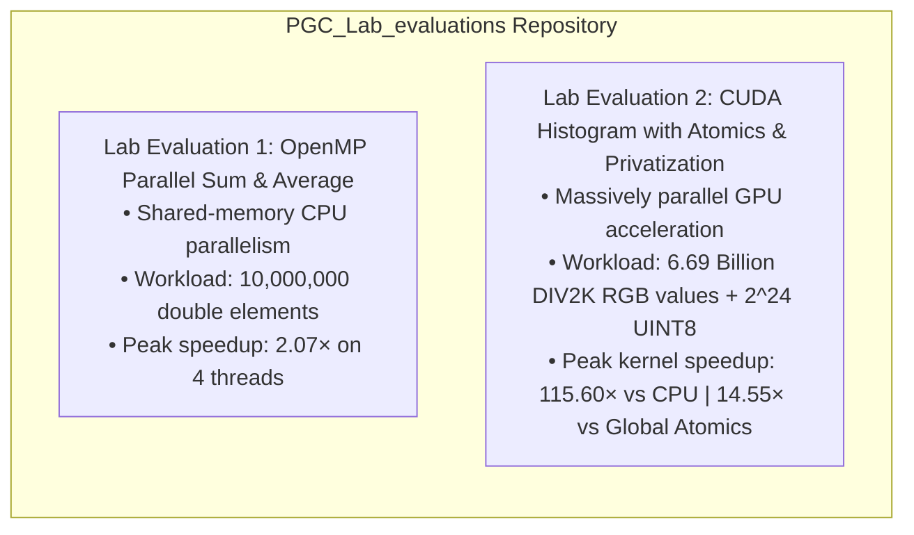

# Parallel & GPU Computing: Laboratory Evaluations Suite

[-brightgreen.svg)](#)

---

## Overview

This repository archives the official implementations, benchmark methodologies, empirical performance measurements, and technical documentation for the **Parallel & GPU Computing (CS60012)** laboratory evaluations.

---

## Directory Index

| Module | Description | Primary Technology | Key Workload | Peak Speedup | Link |
|:---|:---|:---|:---|:---:|:---:|
| **[Lab Evaluation 1](./Lab_evaluation_1/)** | Parallel Sum and Average Using OpenMP Reduction | C / OpenMP Multi-Threading | 10M Elements (~80 MB) | **2.07×** (4 Threads) | [View Module](./Lab_evaluation_1/) |
| **[Lab Evaluation 2](./Lab_evaluation_2/)** | CUDA Histogram Computation (Global Atomics vs Shared Privatization) | CUDA C++17 / NVCC (`sm_120`) | 6.69 Billion Values (~6.23 GB) | **115.60×** (Kernel vs CPU) | [View Module](./Lab_evaluation_2/) |

---

## Evaluation Highlights

### [Lab Evaluation 1: Parallel Sum and Average Using OpenMP](./Lab_evaluation_1/)
- **Theme:** Shared-Memory CPU Multi-Threading and Reduction Hazards.
- **Problem:** Eliminating race conditions on shared sum accumulators across $1, 2, 4, 8,$ and $12$ threads using OpenMP `reduction(+:sum)`.
- **Finding:** Achieved an optimal **2.07× speedup on 4 physical performance cores**. Beyond 4 threads, thread barrier synchronization overhead and CPU memory bus contention offset parallel gain.

---

### [Lab Evaluation 2: CUDA Histogram Optimization](./Lab_evaluation_2/)
- **Theme:** Theme 3 – Histogram Computation with Atomics and Shared-Memory Privatization.
- **Problem:** Eliminating GPU atomic contention and write serialization when thousands of threads update identical histogram bins in global VRAM.
- **Implementations Evaluated:**
  1. Single-threaded CPU Reference Baseline (`cpu_histogram.cpp`).
  2. CUDA Global Atomics (`global_histogram.cu`).
  3. CUDA Shared-Memory Privatization (`shared_histogram.cu`).
- **Core Results:**
  - **DIV2K Real-World Benchmark (6.69 Billion Values):** Shared-memory privatization achieved **50.64 ms** kernel duration, delivering a **115.60× speedup over the CPU** and a **14.55× speedup over GPU global atomics**.
  - **90% Skew Contention Analysis:** Under heavy distribution skew, global atomics degraded to $6.40\text{ ms}$, whereas shared-memory privatization remained immune at $0.0505\text{ ms}$ (**126.85× improvement ratio**).
  - **AI Extensions:** Includes on-device INT8 quantization calibration and a 256-thread Hillis-Steele parallel CDF prefix sum.

---

## Hardware and Software Environment

All experimental results were measured on bare-metal physical hardware:

| Component | Specification |
|:---|:---|
| **CPU** | 13th Gen Intel Core i5-13400 (10 Cores, 16 Threads, up to 4.60 GHz) |
| **System RAM** | 31.77 GiB DDR5 (~32 GB) |
| **GPU** | NVIDIA GeForce RTX 5060 Ti (16 GB GDDR6, Compute Capability 12.0) |
| **Architecture** | Blackwell / Ada-Lovelace Generation (`sm_120`) |
| **Operating System** | Windows 11 Professional (Build 26200) |
| **Compilers** | MSVC Build Tools 2022 / NVIDIA NVCC (CUDA 13.5, Driver 610.88) |

---

## Author

- **Janaki M**  
- **Course:** Parallel & GPU Computing (CS60012)
